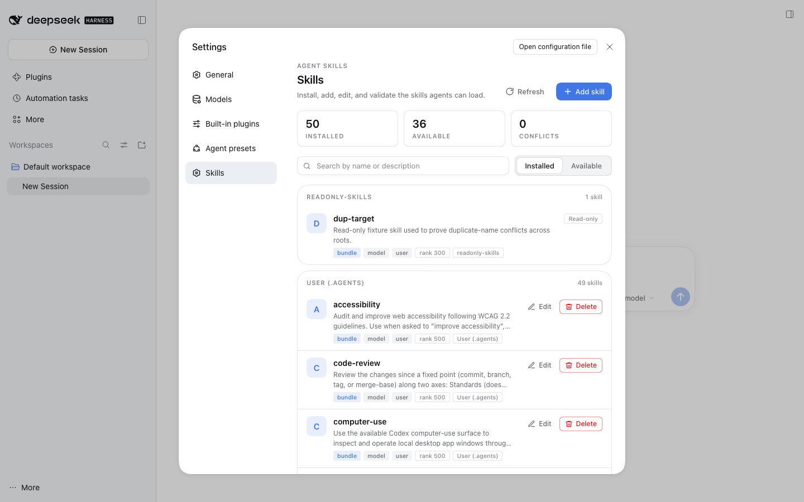
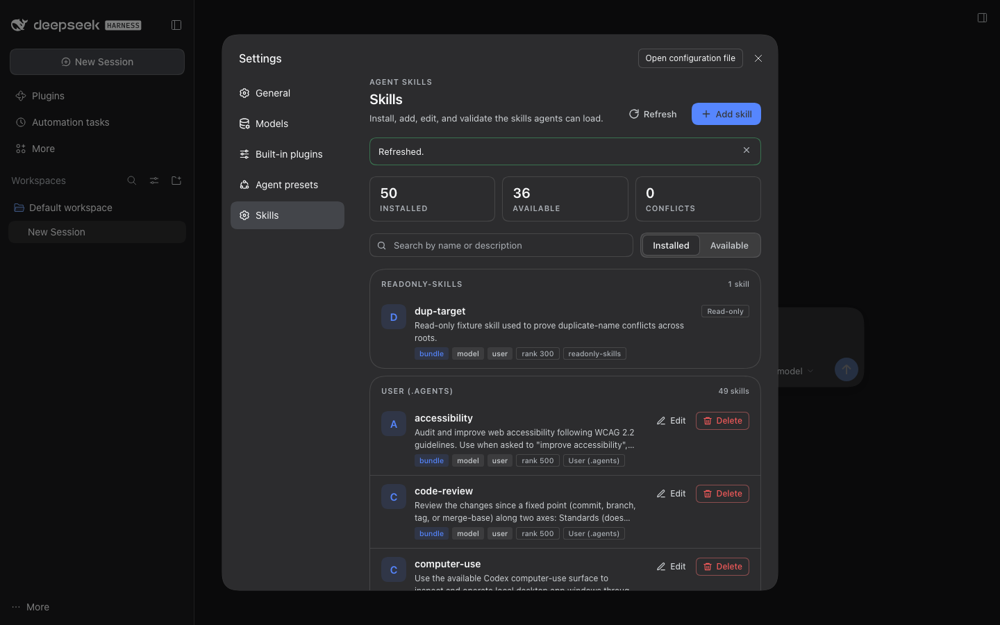
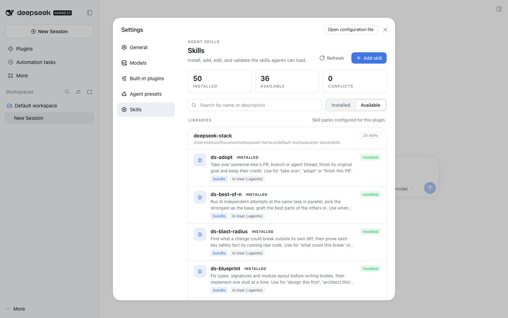
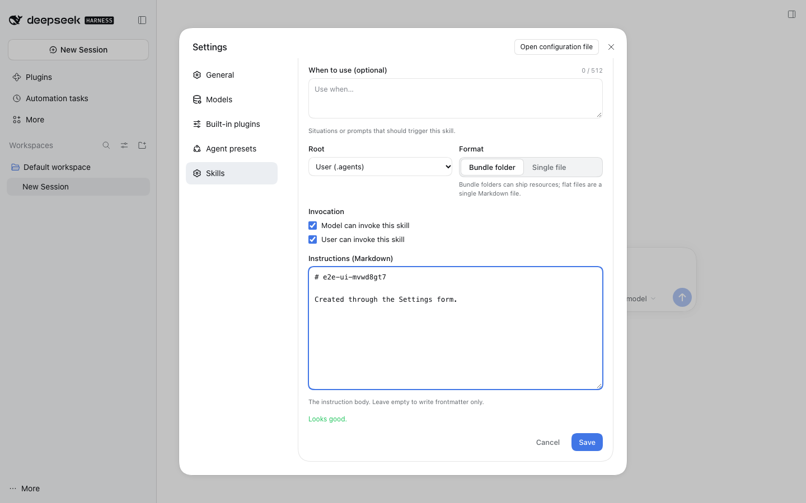
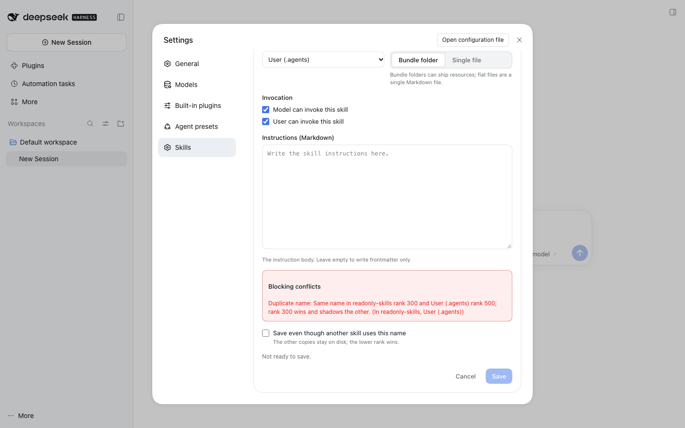
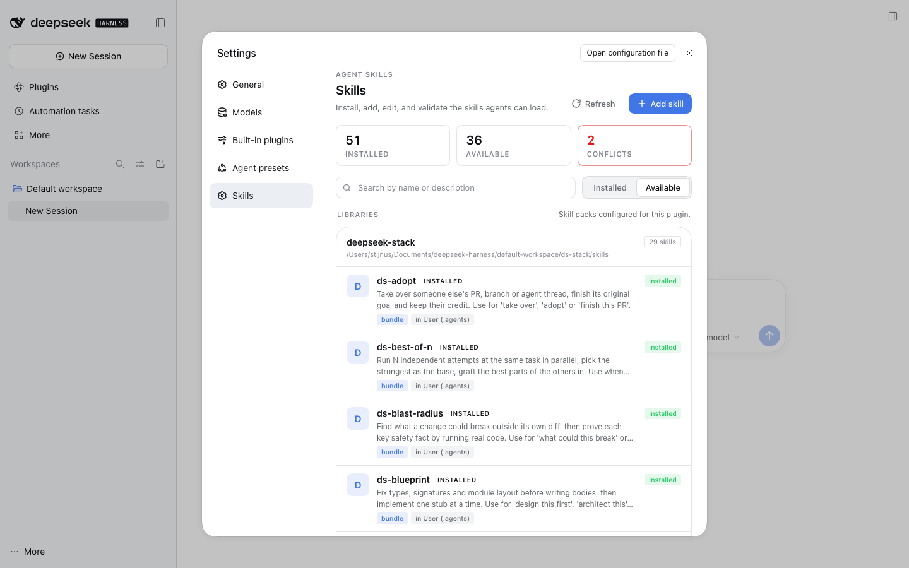

# dsh-skills-manager

[](https://github.com/Stijnus/dsh-skills-manager/actions/workflows/test.yml) [](https://www.npmjs.com/package/dsh-skills-studio)

A **Skills** page for DeepSeek Harness Settings: see every installed agent skill, see what
the registry actually serves to agents, add or edit skills on disk, and block conflicting
saves before they happen.



## What it adds

- **Installed** — every skill discovered in the local DSH skill roots, grouped per root:
  project `.dsh/skills` / `.agents/skills`, custom dirs, `~/.dsh/skills`, `~/.agents/skills`.
  Rows show name, description, bundle vs flat, invocation flags, rank and shadowing; entries
  in the writable root (`~/.agents/skills` by default) have **Edit** and **Delete**.
- **Available** — skills from configured skill-pack **libraries** (Install / Update /
  Installed), plus read-only skills that plugin bundles contribute to the live registry
  ("From plugins").
- **Add / Edit** — a real form (name, description, when-to-use, invocation flags, body) that
  writes `<root>/<name>/SKILL.md` or `<root>/<name>.md` atomically, with optimistic
  concurrency (`expectedSha256`) so an external edit is never silently overwritten.
- **Conflicts before save** — duplicate names across roots, flat-vs-bundle alias collisions
  and description-trigger overlap are detected *before* writing; blocking conflicts return
  409 and the UI explains why. "Force save" is offered only for name shadowing, never for
  invalid fields or stale files.
- **Live proof agents can see it** — after every mutation the host asks `ctx.skills` what the
  registry serves and reports a three-state result: `visible: true` ("Saved · agents can see
  it now"), `visible: false` while a polling deadline is missed, or `checked: false` when the
  host-scope registry view cannot see the per-session filesystem provider at all (the real
  desktop composition). In the last case the UI says the host cannot verify the session
  catalog from here instead of claiming a false negative; the shipped filesystem provider
  watches the written root and surfaces the change to agents on their next step.

No model calls, no network, no shell. File writes are restricted to the configured writable
root, with path/symlink containment and 256 KiB skill / 1 MiB request caps.

## Screenshots

All captures come from an isolated scratch DSH 0.2.1-rc.5 instance with a copy of the 49-entry
user skill root plus the deepseek-stack libraries; the app's theme is the only difference in
the dark frame. Image files live in [`verify/screenshots/`](verify/screenshots/).

| Light | Dark |
|---|---|
|  |  |

| Available tab (libraries + "From plugins") | Add / edit editor with live validation |
|---|---|
|  |  |

| Duplicate name blocked before saving | Host-scope catalog note (desktop topology) |
|---|---|
|  |  |

More verification images (saved state, delete confirmation, dark Available tab) are in the same
directory; the raw evidence and harnesses are described in
[`SKILLS-VERIFICATION.md`](SKILLS-VERIFICATION.md).

## Install

### From npm (registry)

```bash
# latest release
dsh plugin --profile <profile> add dsh-skills-studio

# pin a version
dsh plugin --profile <profile> add dsh-skills-studio@0.1.2
```

The project is called **dsh-skills-manager**, but its npm package is **`dsh-skills-studio`**:
the unscoped `dsh-skills-manager` name belongs to an unrelated third-party plugin, and the
previous `@stijnus/...` scope has been retired. GitHub and local-link installs remain
available below.

### Local development (web profile, isolated)

```bash
git clone https://github.com/Stijnus/dsh-skills-manager.git
cd dsh-skills-manager
DSH_HOME=/tmp/dsh-skills-dev dsh plugin --profile web add link:$PWD
DSH_HOME=/tmp/dsh-skills-dev dsh --profile web --port 53999 --no-open
```

Or install straight from this repository into an existing profile:

```bash
# latest main
dsh plugin --profile <profile> add github:Stijnus/dsh-skills-manager

# pin a released version (recommended for stable installs) — see the Releases page
dsh plugin --profile <profile> add github:Stijnus/dsh-skills-manager#v0.1.2
```

Releases are tagged `vX.Y.Z` ([Releases](https://github.com/Stijnus/dsh-skills-manager/releases)). To upgrade, install the newer tag the same way; a profile reload applies it (HMR picks it up when enabled).

> **npm name note:** the package is published as `dsh-skills-studio` because the plain
> `dsh-skills-manager` name on npm belongs to an unrelated third-party plugin. The GitHub/link
> forms above are fallbacks for development checkouts.

Overlay config for an isolated run (agents home, writable root and libraries):

```yaml
# skills-manager.overlay.yml — pass with --patch
- id: skills-manager
  config:
    agentsHome: /tmp/dsh-skills-dev/agents
    writableRoot: /tmp/dsh-skills-dev/managed-skills
    libraries:
      - id: deepseek-stack
        label: deepseek-stack
        path: /absolute/path/to/ds-stack/skills
      - id: deepseek-stack-aliases
        label: deepseek-stack aliases
        path: /absolute/path/to/ds-stack/aliases
```

### Desktop app

Use **Settings → Plugins → install bundle** with this directory as the target (the Desktop
shell performs the package operation and recomposes the app). After installation the
**Skills** section appears in Settings immediately; a restart is only needed if the shell
reports `restart-required`.

The current live install on this machine uses the hand-managed profile path instead: a
`node_modules/dsh-skills-manager` symlink plus a profile-patch row (see
[SKILLS-VERIFICATION.md](SKILLS-VERIFICATION.md) §4). DSH's profile HMR loads both halves
into the running app without a restart. Durability caveat: because the profile
`package.json` does not declare the package, a later plugin-manager / pnpm operation can
prune the symlink; re-run the desktop plugin install (or add the `link:` dependency) after
such an operation. The profile patch keeps the row, so a restart with the symlink restored
brings the section back.

## Configuration

All fields optional. Config is validated at apply time; a malformed value throws instead of
silently defaulting.

| Field | Default | Meaning |
|---|---|---|
| `agentsHome` | `$DSH_AGENTS_HOME` or `~/.agents` | User agent config root; `skills/` is the writable root by default |
| `dshHome` | `$DSH_HOME` or `~/.dsh` | Harness config root; its `skills/` is scanned read-only |
| `writableRoot` | `<agentsHome>/skills` | The only root this plugin may write to |
| `includeUserDshRoot` | `true` | Scan `<dshHome>/skills` |
| `includeProjectRoots` | `true` | Scan project roots when the API call supplies `cwd` |
| `customSkillDirs` | `[]` | Extra read-only skill roots (rank 300) |
| `libraries` | `[]` | Installable skill packs: `{ id?, label?, path }` |
| `maxSkillBytes` | `262144` | Instruction-file / body size cap |

Deepseek-stack note: `libraries` pointing at `ds-stack/skills` and `ds-stack/aliases` makes
the 29 bundle skills and 6 gesture aliases visible in Available, with Installed/Update status
computed against the writable root. Because the aliases are flat files, install them as a
separate library entry.

## HTTP API (host half, same origin)

Prefix `/skills-manager/api`, JSON, `cache-control: no-store`.

| Method + path | Purpose |
|---|---|
| `GET /state?cwd=` | roots, installed skills, libraries with installed/update/available status, live registry catalog, conflicts, stats |
| `GET /skill?rootId=&relPath=` | one skill with its full instruction text |
| `POST /validate` | dry-run field validation + conflicts/warnings for a create/update draft |
| `POST /save` | create/update (atomic write, optimistic sha, registry visibility probe) |
| `POST /delete` | remove an entry from a writable root (expected sha required) |
| `POST /install` | copy a library skill into the writable root (update requires overwrite + expected sha) |
| `GET /health` | liveness + resolved roots |

The full request/response contract, conflict rules and write format are in
[`CONTRACT.md`](CONTRACT.md).

## Verification

- Host logic: `node --test` → 105 tests, no dependencies, temp dirs only.
- Independent end-to-end verification: 61/61 host API assertions against a real scratch DSH
  instance, 28/28 real-browser GUI assertions (add/edit/delete/install, duplicate blocked
  before save, a11y, light+dark), desktop delivery proven live (HMR, no restart), and the
  49-entry installed-skills invariant re-audited: [`SKILLS-VERIFICATION.md`](SKILLS-VERIFICATION.md).
- Baseline audit of the installed skill roots and the deepseek-stack pack:
  [`SKILLS-AUDIT.md`](SKILLS-AUDIT.md).

## Known limitations

- Discovery is one level deep per root, matching the shipped filesystem provider
  (`<root>/<name>/SKILL.md`, `<root>/<name>.md`); nested skill trees are not discovered.
- Project roots need a `cwd`: the page forwards one when the client's optional `sessions`
  service exposes a session workspace, and otherwise shows the user-scope roots it can resolve
  on its own. Root discovery itself is one level deep, matching the shipped provider.
- The registry visibility probe reports what the host-scope `ctx.skills` view serves. In the
  real desktop composition the local filesystem provider lives in the per-session agent preset
  layer, so the probe truthfully returns `checked:false` and the UI says the session catalog
  cannot be verified from here; the provider's watcher still surfaces the change to agents on
  their next step. A provider that never watches its root would need its own invalidation.
- The plugin never edits files it does not own: deletions are limited to scanned entries
  under the writable root and require the exact sha256 the UI read.
